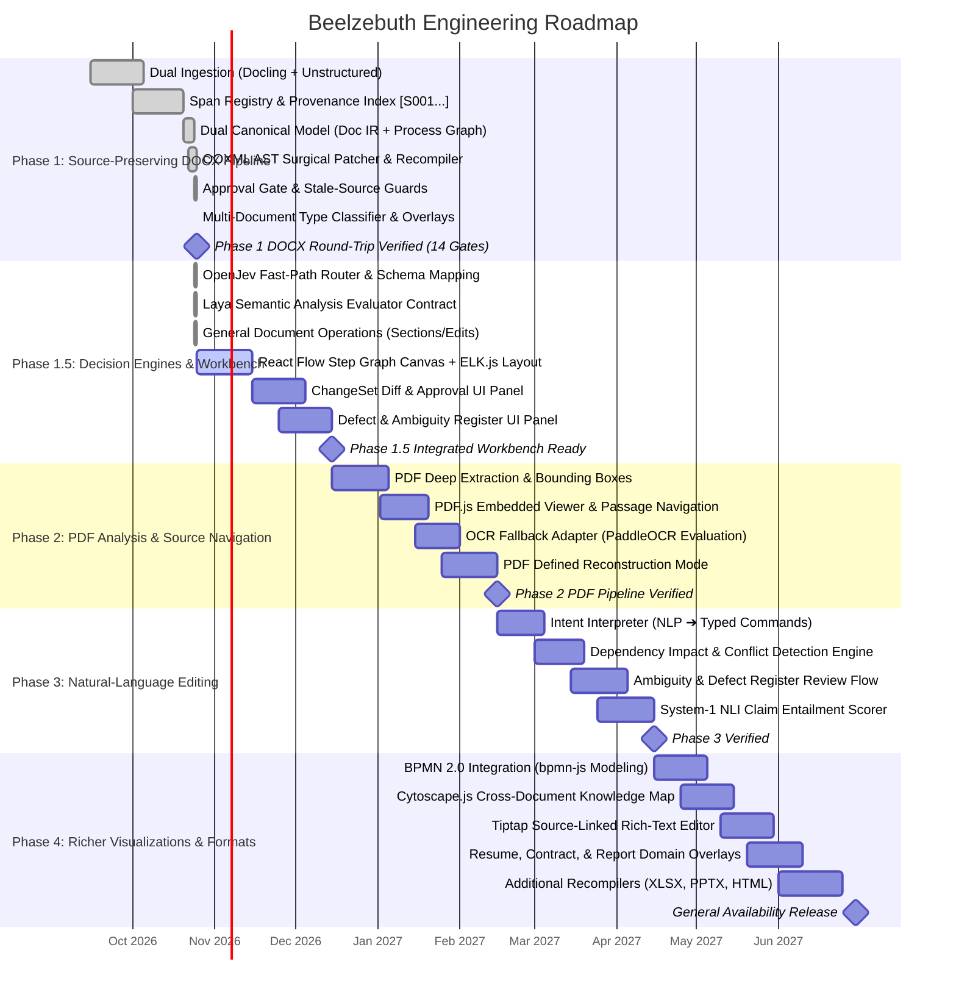

# Beelzebuth — Implementation Roadmap & Gantt Schedule (Locked)

> **Visual Document Intelligence & Transformation Engine**  
> *Phased implementation plan, core milestones, and regression benchmarks.*

---

## 1. Core Milestone Strategy

The foundation of Beelzebuth is not an ungrounded AI chat or fragile markdown export: **it is a source-preserving document intelligence engine with a dual Canonical Document Model, specialized decision-making engines (OpenJev for fast routing, Laya for semantic consistency), deterministic Change Engine control, and format-specific recompilation.**

Having verified Phase 1 (source-preserving DOCX round-trip editing with 14 acceptance gates on enterprise fixtures), Beelzebuth supports multi-document classification (`MANUAL`, `RESUME`, `CONTRACT`, `RESEARCH_PAPER`, `REPORT`, `GENERIC`), stable block fingerprints, and procedure-scoped AST surgery. The same Canonical Document Model powers upcoming visual views across phased releases (React Flow canvas and ELK.js layout in Phase 1.5; PDF.js passage viewer in Phase 2; bpmn-js, Cytoscape.js, and Tiptap in Phase 4) and format writers (PDF, XLSX, PPTX, HTML) without architectural rewrites.

---

## 2. Mermaid Gantt Chart

---

## 3. Detailed Phase Breakdown

### Phase 1: Source-Preserving DOCX Pipeline (Completed & Verified)
*Goal: Prove that real DOCX documents can be parsed into stable IR, visualized, safely edited via typed commands, recompiled via AST patching, and verified end-to-end.*
- [x] Ingest DOCX documents using Docling and Unstructured backends.
- [x] Segment document into atomic sentences with stable span IDs `[S001]...`.
- [x] Implement Canonical Document Model:
  - Model A (`DocumentIR`): headings, paragraphs, lists, tables, callouts, captions, citations, equations, clauses, stable block IDs, XPath locations, fingerprints, XML signatures.
  - Model B (`SemanticProcessGraph`): procedural steps, actors, prerequisites, dependency edges (`DEPENDS_ON`, `SEQUENCE`, `EXPLAINS`, `WARNS_ABOUT`).
- [x] Multi-Document Classification: automatic `DocumentType` detection (`MANUAL`, `RESUME`, `CONTRACT`, `RESEARCH_PAPER`, `REPORT`, `GENERIC`).
- [x] Typed Change Engine (`change_engine.py`):
  - Strict approval gate (`COMPILABLE_STATUSES = {"APPROVED"}`).
  - Dependency cycle detection via DFS.
  - Procedure scope enforcement via `step_parent_map` (rejects invalid cross-section moves).
  - Empty update rejection.
- [x] Surgical OOXML AST Patcher (`docx_patcher.py`):
  - Targeted `zipfile` + `lxml` surgery updating only modified XML elements.
  - Fail-closed paragraph matching (structural index + fingerprint + exact text).
  - Pre-mutation unsupported structure detection across entire procedure scope (tracked changes, SDT, cross-paragraph bookmarks/comments).
  - Mixed-run formatting protection for text updates.
  - Scoped literal prefix resequencing (`Step 1`, `1.`, `a)`).
- [x] Round-Trip Pipeline & Verification (`docx_pipeline.py`):
  - Pre-mutation source re-hashing to prevent editing stale files.
  - One-to-one block reconciliation (`matched_reopened_ids`) preventing false positive matches.
  - Exact structural position verification for updates.
  - 14/14 automated acceptance gates passed, including real enterprise DOCX fixtures (4,840 blocks, 110 tables).

### Phase 1.5: Decision Engines & Workbench UI Integration (Target: Q4 2026)
*Goal: Connect the verified DOCX round-trip engine to the React Flow visual editor, OpenJev fast path, and Laya semantic analysis.*
- [x] Backend: OpenJev Fast-Path Router (`openjev_router.py`): request classification and fast-path dispatch to structured operations.
- [x] Backend: Laya Semantic Analysis Evaluator (`laya_evaluator.py`): semantic entailment, negation detection, and factual consistency checks for rewritten text.
- [x] Backend: General Document Operations: `REORDER_SECTION` (e.g. Resume Skills before Education), `EDIT_PARAGRAPH_TEXT`, and table/hyperlink XML surgery.
- [ ] UI: React Flow Step Graph Canvas + ELK.js Layout connected to `DocumentEditSession`.
- [ ] UI: ChangeSet Diff & Approval UI Panel with before/after comparison and cryptographic approval flow.
- [ ] UI: Defect & Ambiguity Register UI Panel for unsupported document structures and semantic warnings.

### Phase 2: PDF Analysis & Source Navigation (Target: Q1 2027)
*Goal: Bring multi-page PDF documents into the visual editing workflow with exact page/passage navigation.*
- [ ] Deep extraction with bounding box coordinates and page numbers.
- [ ] Integrate **PDF.js** in left pane: clicking a workflow node scrolls PDF directly to supporting passage.
- [ ] Evaluate specialist OCR (PaddleOCR / PP-Structure) for scanned pages.
- [ ] Define **PDF Reconstruction Mode**: reconstruct clean, structured DOCX or Markdown from PDF evidence.

### Phase 3: Natural-Language Editing (Target: Q1-Q2 2027)
*Goal: Enable users to type natural-language instructions and convert them into typed change commands.*
- [ ] LLM intent interpretation: parse queries like *"Move BIOS configuration after Windows install"* into `TypedChangeCommand`.
- [ ] Dependency impact checker: evaluate prerequisite conflicts.
- [ ] Identify impacted explanatory prose blocks (`EXPLAINS` edges) and flag them in review panel.
- [ ] Multi-tier verification: score evidence as `STRONG`, `MODERATE`, `WEAK`, or `NONE`.
- [ ] Quarantined review flow: user must approve ambiguous or consequential changes before recompilation.

### Phase 4: Richer Visualizations & Format Writers (Target: Q2 2027)
*Goal: Provide specialized visual views and expand format-specific recompilers.*
- [ ] Formal BPMN 2.0 modeling with **bpmn-js** for enterprise compliance and XML export.
- [ ] Cross-document relationship exploration with **Cytoscape.js** (roles, warnings, prerequisites).
- [ ] **Tiptap / ProseMirror** source-linked rich-text editor with transactional history.
- [ ] Domain-specific visual overlays for Resumes (experience timeline), Contracts (clause hierarchy), and Research Papers (citation network).
- [ ] Additional format writers: **XLSX** via `openpyxl`, **PPTX** via `python-pptx`, and **HTML**.

---

## 4. The Regression Corpus & Reliability Metrics

To declare Beelzebuth reliable, we run automated regression benchmarks across real enterprise fixtures:
- `sample_docs/Workstation_Deployment_Guide.docx` (Controlled multi-step SOP with warnings and tables)
- `/home/jefino9488/Documents/carebank-backend.docx` (4,840 blocks, 110 tables real enterprise codebase archive)
- `/home/jefino9488/Documents/CareBank-Code Akasha-Architecture Document.docx` (309 blocks, 40 headings real enterprise architecture document)

### Mandatory Reliability Metrics
1. **Source-Anchor Coverage**: >= 98% of extracted steps must map to valid `SpanAnchor` entries in the source document.
2. **Step-to-Evidence Correctness**: Step action verbs and actors must entail from linked source blocks.
3. **Graph Extraction Fidelity**: 0 hallucinated loops or phantom steps; cycles strictly detected and rejected.
4. **Style Retention Score**: >= 99% font, margin, and layout element preservation on untouched DOCX sections.
5. **Reordered Content Correctness**: Reordered steps must appear in the exact intended sequence in the recompiled output.
6. **Round-Trip Survivability**: Reopening the exported document through the ingestion engine must verify that all approved changes are present and unmodified blocks are identical.
