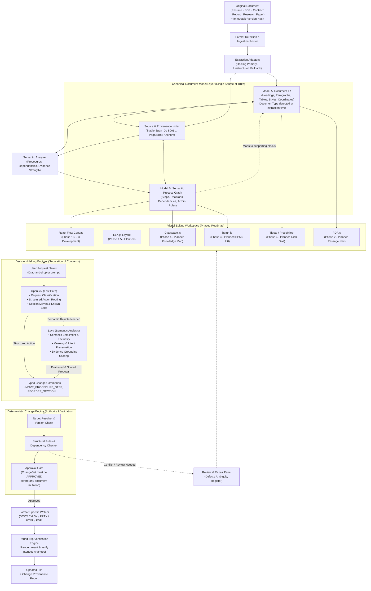

# Beelzebuth — Visual Document Intelligence & Transformation Engine

> **Make documents editable through their meaning and structure, rather than only through their pages.**

Beelzebuth is a general-purpose visual document understanding and editing system. It enables users to modify the underlying procedures, content, and relationships inside complex documents — resumes, technical manuals, contracts, research papers, and business reports — without manually navigating every page.

```
┌────────────────────────────────────────────────────────────────────────────────────────┐
│                                       BEELZEBUTH                                       │
│                     Visual Document Intelligence & Transformation                      │
├─────────────────────┬──────────────────────────┬───────────────────────────────────────┤
│    1. INGESTION     │  2. CANONICAL MODEL      │         3. VISUAL EDITING             │
│  Docling TableFormer│  Model A: Document IR    │  React Flow (Dev) · ELK.js (Planned)  │
│  Unstructured       │  Model B: Semantic Graph │  Cytoscape · bpmn-js · Tiptap (Plan)  │
├─────────────────────┴──────────────────────────┴───────────────────────────────────────┤
│                     4. DUAL DECISION-MAKING & CONTROL ENGINES                          │
│  • OpenJev (Fast Path): Intent classification & structured action dispatch             │
│  • Laya (Semantic Analysis): Entailment, factuality & meaning preservation checks     │
│  • Change Engine (Deterministic Control): Target resolution, rules & approval gate    │
├────────────────────────────────────────────────────────────────────────────────────────┤
│                          5. FORMAT-SPECIFIC RECOMPILATION                              │
│      Same-Format Preservation (DOCX via OpenXML AST) | Defined PDF Reconstruction      │
│          3-Way Traceability · 4-Tier Evidence Scoring · Round-Trip Verification        │
└────────────────────────────────────────────────────────────────────────────────────────┘
```

---

## The Two Core Deliverables

Beelzebuth is engineered around one shared document-operation engine, accessible through two primary entry points:

```
                  ┌─────────────────────────────────────────────────────────┐
                  │                 TWO PRIMARY ENTRY POINTS                │
                  └────────────┬───────────────────────────────┬────────────┘
                               │                               │
                               ▼                               ▼
               ┌───────────────────────────────┐ ┌───────────────────────────────┐
               │  1. STANDALONE OPEN-SOURCE    │ │   2. BEELZEBUTH MCP SERVER    │
               │          APPLICATION          │ │                               │
               │ • React Web Workbench UI     │ │ • Stdio JSON-RPC Server       │
               │ • Python CLI (`injester`)     │ │ • Claude Desktop & Cursor     │
               │ • REST API & Visual Graphs    │ │ • AI Agents & LLM Tool Calls  │
               │ • BYOAI (OpenRouter / Gemini) │ │ • Autonomous Document Tools   │
               └───────────────┬───────────────┘ └───────────────┬───────────────┘
                               │                               │
                               └───────────────┬───────────────┘
                                               │
                                               ▼
               ┌───────────────────────────────────────────────────────────────┐
               │               SHARED DOCUMENT-OPERATION ENGINE                │
               │  Sessions · Ingestion · ChangeSets · Approval Gate · Verify   │
               └───────────────────────────────┬───────────────────────────────┘
                                               │
                                               ▼
               ┌───────────────────────────────────────────────────────────────┐
               │      CANONICAL DOCUMENT MODEL (CDM) + CHANGE ENGINE           │
               │  Model A (Document IR) ◄──► Model B (Semantic Process Graph)  │
               │  Typed Change Commands ➔ HMAC-SHA256 Gate ➔ Format Patchers   │
               └───────────────────────────────────────────────────────────────┘
```

1. **Standalone Open-Source Beelzebuth**:
   - A self-hosted document intelligence and transformation application.
   - Users bring their own AI provider and model (BYOAI: OpenRouter, Gemini, Ollama, OpenAI-compatible) or run completely offline with local verifiers.
   - Interactive React Web Workbench (`injester web`), terminal CLI (`injester`), and REST API.
   - Visual procedure workflows, 3-way traceability, defect registers, and 4-pillar roundtrip verification.

2. **Beelzebuth Model Context Protocol (MCP) Server**:
   - Exposes document understanding, search, editing, and verification capabilities as standardized MCP tools (`injester mcp` or `python -m injester.mcp`).
   - External AI clients (Claude Desktop, Cursor, Goose, autonomous agents) invoke document tools directly without running a redundant second LLM.
   - **Enforced Security Boundary**: Agents can inspect documents, propose typed changes, and preview diffs. In default manual mode, execution is gated by a single-use human approval token tracked transactionally in SQLite (`SHA-256` token hash, atomic compare-and-set). Models cannot self-approve their own changes.

---

## The Core Problem

Consider a **200-page PC Installation & Maintenance Manual**:

- It contains intricate procedures for installing operating systems, configuring BIOS/UEFI settings, setting RAID arrays, and installing hardware drivers.
- A systems engineer wants to modify an installation step or move the BIOS boot configuration before the storage provisioning step.
- In traditional tools, the engineer must manually hunt across hundreds of pages, find every scattered reference, cross-check prerequisites, rewrite paragraphs, re-align page numbers, and pray that tables of contents and cross-references didn't break.
- With **Beelzebuth**, the user asks to find the installation procedure. Beelzebuth isolates the procedural sequence, identifies dependent sections, and presents it as an **editable visual workflow**.
- The engineer drags the step to its new position or instructs the AI to update the driver requirements.
- Beelzebuth updates the underlying Canonical Document Model, verifies that dependent steps are not orphaned, displays a clear visual diff, and **recompiles the modified document back into its original format** with formatting preserved.

The same workflow applies to resumes, contracts, research papers, and business reports. **The document type controls which semantic overlays are active**, not which edits are possible.

---

## 1. Locked System Architecture

Beelzebuth combines mature open-source tools with one proprietary, tightly engineered core: **the Canonical Document Model (CDM) and the bidirectional mapping between visual edits and the original document package.**



---

## 2. Supported Document Types

Beelzebuth detects the document type at extraction time using a heuristic classifier on heading vocabulary and filename. The detected type controls which semantic overlays are active — **not** which edits are possible.

| Document Type | Detection Signals | Active Overlays | Native Actions |
| :--- | :--- | :--- | :--- |
| **MANUAL** | Heading keywords: procedure, step, installation, setup, warning; numbered list density; filename: guide, sop, manual | Procedural step extraction (`GroundedStep`), dependency graph | `MOVE_PROCEDURE_STEP`, `UPDATE_STEP_INSTRUCTION` |
| **RESUME** | Filename: resume, cv, curriculum vitae; >= 3 heading keywords: experience, education, skills, objective, certification | Section reordering, experience bullet factuality checks | `REORDER_SECTION`, `EDIT_PARAGRAPH_TEXT` |
| **CONTRACT** | Filename: contract, agreement, nda; >= 2 heading keywords: clause, obligation, whereas, indemnify | Clause navigation, obligation modality checks | `REORDER_SECTION`, `EDIT_PARAGRAPH_TEXT` |
| **RESEARCH_PAPER** | Filename: paper, thesis, dissertation; >= 3 heading keywords: abstract, methodology, references | Citation graph, figure/table navigation | `REORDER_SECTION`, `EDIT_PARAGRAPH_TEXT` |
| **REPORT** | Filename: report, proposal, analysis; >= 2 heading keywords: executive summary, findings, recommendation | Section reordering, general text editing | `REORDER_SECTION`, `EDIT_PARAGRAPH_TEXT` |
| **GENERIC** | Default for all unclassified documents | Procedural step extraction (default safe fallback) | All operations supported |

---

## 3. The Two Linked Models in Canonical Document Model

Beelzebuth rejects the naive approach of using one giant graph. It enforces a strict separation between what is physically in the source and the semantic meaning derived from it:

```
┌────────────────────────────────────────────────────────────────────────────────────────┐
│                        CANONICAL DOCUMENT MODEL (CDM)                                  │
├───────────────────────────────────────────┬────────────────────────────────────────────┤
│         MODEL A — DOCUMENT IR             │        MODEL B — SEMANTIC OVERLAYS         │
│   (Faithful Structural Source Representation)│    (Domain-Appropriate Semantic Meaning)   │
├───────────────────────────────────────────┼────────────────────────────────────────────┤
│ • Headings, Paragraphs, Lists, Tables     │ • Procedures, Steps, Gateways, Decisions   │
│ • Stable internal block IDs (block-001...) │ • Actors, Tools, Preconditions, Outputs    │
│ • DocumentType classification             │ • Directed dependency edges (DEPENDS_ON)   │
│ • Formatting metadata (styles, runs, XML) │ • Links each node to >= 1 source blocks    │
│ • Physical source anchors (page, bbox)    │ • Retains inference confidence & evidence  │
│ • Extended block types: FIGURE_CAPTION,   │ • procedure_parent_block_id scope          │
│   CITATION, EQUATION, CLAUSE              │   enforcement prevents cross-section moves │
└───────────────────────────────────────────┴────────────────────────────────────────────┘
```

---

## 4. Decision-Making Engines: Separation of Responsibilities

A key design principle in Beelzebuth is **specialized roles for decision-making models** rather than expecting one model to do everything:

1. **OpenJev (Fast Path Router)**:
   - Quickly classifies user requests into supported structured actions (e.g., *"Move Skills before Education"* ➔ `REORDER_SECTION`).
   - Handles known, direct edit commands without expensive generative LLM calls.
   - Routes requests requiring generative rewriting to the semantic path.

2. **Laya (Semantic Analysis Engine)**:
   - Evaluates meaning preservation, intent, and factual consistency against cited original source spans (`[S001]`).
   - Assesses whether an AI-rewritten resume bullet, updated SOP instruction, or revised contract clause remains grounded in the source facts.
   - Evaluates obligation modality (`mandatory`, `permissive`, `prohibitive`) and flags unsupported additions.

3. **Change Engine (Deterministic Control & Recompilation)**:
   - Owns the document boundary: resolves targets, checks document versions, enforces structural constraints, and enforces the `APPROVED` gate.
   - **Neither OpenJev nor Laya can bypass the Change Engine or directly mutate document files.**

---

## 5. The Open-Source Component Stack

| Layer | Component | License | Role in Beelzebuth |
| :--- | :--- | :--- | :--- |
| **Document Extraction** | **[Docling](https://github.com/docling-project/docling)** | MIT | Primary structured extraction with TableFormer deep learning table recognition and reading order. |
| **Extraction Fallback** | **[Unstructured](https://github.com/Unstructured-IO/unstructured)** | Apache 2.0 | Alternative extraction adapter for heterogeneous document layouts. |
| **Fast Path Router** | **OpenJev** | Open Weights | Request classification and structured action routing. |
| **Semantic Verifier** | **Laya** | Open Source | Non-autoregressive semantic entailment and meaning preservation checks. |
| **Workflow Canvas** | **[React Flow](https://github.com/xyflow/xyflow)** | MIT | In Development (Phase 1.5) — Draggable, interactive procedural step graph canvas. |
| **Graph Auto-Layout** | **[ELK.js](https://github.com/kieler/elkjs)** | EPL 2.0 | Planned (Phase 1.5) — Automatic diagram node layout and edge routing. |
| **Source PDF View** | **[PDF.js](https://github.com/mozilla/pdf.js)** | Apache 2.0 | Planned (Phase 2) — In-browser PDF renderer navigating directly to source page/passage. |
| **Formal BPMN** | **[bpmn-js](https://github.com/bpmn-io/bpmn-js)** | bpmn.io | Planned (Phase 4) — Formal BPMN 2.0 viewer and XML editor for enterprise modeling. |
| **Knowledge Maps** | **[Cytoscape.js](https://github.com/cytoscape/cytoscape.js)** | MIT | Planned (Phase 4) — Cross-document relationship exploration (roles, warnings, prerequisites). |
| **Rich Text Editor** | **[Tiptap](https://tiptap.dev/) / ProseMirror** | MIT | Planned (Phase 4) — Source-linked rich-text blocks and outline editing with transactional history. |
| **DOCX Writer** | **zipfile + lxml** | MIT / BSD | Office Open XML package patcher updating only affected XML nodes. |
| **Spreadsheet Writer**| **[openpyxl](https://openpyxl.readthedocs.io/)** | MIT | Workbook editor preserving formulas, styles, and sheet references. |
| **Presentation Writer**| **[python-pptx](https://python-pptx.readthedocs.io/)** | MIT | Presentation slide and shape editor. |

---

## 6. The Typed Change Engine & Approval Gate

Visual drag-and-drop actions and AI prompts generate explicit, typed change commands:

```json
{
  "operation": "MOVE_PROCEDURE_STEP",
  "target_step_id": "step-bios",
  "before_step_id": "step-windows",
  "source_block_ids": ["block-104", "block-105"],
  "procedure_parent_block_id": "block-002",
  "expected_document_version": "v_abc123",
  "rationale": "Move BIOS setup before OS installation"
}
```

The Change Engine:
1. Confirms IDs refer to active source-linked content.
2. **Enforces procedure scope**: target and anchor must share the same parent block (cross-section moves are rejected).
3. Checks whether other steps depend on the modified step via the dependency graph (cycle detection included).
4. Identifies affected paragraphs, tables, numbering, and cross-references.
5. Determines if the requested order violates prerequisites or safety constraints.
6. Emits a `PROPOSED` ChangeSet. **The ChangeSet must be set to `APPROVED` before recompilation can occur.** `PROPOSED`, `REJECTED`, and already `APPLIED` ChangeSets are rejected at the compilation boundary.

---

## 7. Three Dimensions of Traceability & Evidence Scoring

```
1. SOURCE GROUNDING
   Which original passage, table cell, image or page supports a procedure or claim?

2. SEMANTIC GROUNDING
   Why does a workflow node exist, and what evidence supports its relationships and dependencies?

3. CHANGE PROVENANCE
   What did the user or AI change, which source elements were affected, and what was added, removed or reordered?
```

### The 4-Tier Validation Rule
- **STRONG**: Direct, clear support in the source document.
- **MODERATE**: Reasonable support, but some contextual interpretation is involved.
- **WEAK**: Indirect or ambiguous support; quarantined in the Defect / Ambiguity Register.
- **NONE**: No supporting evidence identified. Must be explicitly tagged as `[NEW CONTENT: USER PROPOSED]` rather than falsely attributed to the source document.

---

## 8. How Format-Specific Recompilation Works

| Format | Recompilation Approach | Guarantees & Constraints |
| :--- | :--- | :--- |
| **DOCX** | Patch the Office Open XML package using targeted `zipfile` + `lxml` element surgery. Source file is re-hashed immediately before mutation to detect concurrent modification. | **Style-Preserving Same-Format Editing**. Untouched paragraphs, styles, headers, footers, and margins remain identical. One-to-one block matching ensures no dropped blocks. |
| **XLSX** | Modify workbook with `openpyxl`. | Preserves formulas, cell styles, sheet names, and workbook metadata. |
| **PPTX** | Edit slides and shapes with `python-pptx`. | Preserves slide layouts, themes, and master slides. |
| **HTML** | Mutate DOM tree using BeautifulSoup / lxml. | Retains classes, attributes, links, and structure. |
| **PDF** | Constrained in-place updates or clean reconstruction. | PDFs are fixed-layout print artifacts; Beelzebuth provides a defined **reconstruction mode** rather than claiming impossible lossless PDF patching. |

---

## 9. Command Reference

| Command | Description |
| :--- | :--- |
| `injester` / `beelzebuth` | Display system overview and active workspace health. |
| `injester init` | Initialize local workspace database (`injester.db`) and vector store. |
| `injester ingest <file>` | Ingest document using Docling TableFormer or Unstructured backend. |
| `injester md generate -f <file> -o <out.md>` | Devour document into high-fidelity Markdown with tables and citations. |
| `injester diagram generate -f <file>` | Generate visual workflow projections (Mermaid flowchart, BPMN 2.0 XML). |
| `injester search "<query>"` | Semantic vector search across all indexed document evidence chunks. |
| `injester documents list` | List all ingested documents, versions, and chunk counts. |
| `injester web` | Launch local FastAPI server and open React Web Workbench in browser. |
| `injester web --port 8765 --no-browser` | Run web server on specified port without launching browser. |
| `injester mcp` | Launch local stdio Model Context Protocol (MCP) server for AI clients. |
| `injester doctor` | Diagnose environment dependencies, backends, and storage health. |
| `injester config` | View and edit LLM settings, System-1 verifiers, and workspace paths. |

---

## 10. Quickstart & Installation

### Prerequisites
- Python 3.10+ (tested on Python 3.11 through 3.14)
- Node.js 18+ (tested with Bun 1.3+ and npm)

### Installation
```bash
# Clone the repository
git clone https://github.com/Jefino9488/Beelzebuth.git
cd Beelzebuth

# Create and activate virtual environment
python3 -m venv venv
source venv/bin/activate

# Install Python package and dependencies
pip install -e .

# Install frontend dependencies and build assets
cd frontend
bun install # or npm install
bun run build # or npm run build
cd ..
```

### Initialize & Launch
```bash
injester init
injester doctor
injester web
```
The browser opens automatically at `http://127.0.0.1:8000`.

---

## 11. Model Context Protocol (MCP) Integration

Beelzebuth provides a local stdio MCP server (`injester mcp` or `python -m injester.mcp`), exposing document tools to external AI clients such as **Claude Desktop**, **Cursor**, **Goose**, or custom agents.

### Claude Desktop Configuration
Add Beelzebuth to your `claude_desktop_config.json`:
```json
{
  "mcpServers": {
    "beelzebuth": {
      "command": "/path/to/Beelzebuth/venv/bin/python",
      "args": ["-m", "injester.mcp"],
      "cwd": "/path/to/Beelzebuth",
      "env": {
        "WORKSPACE_DIR": "/path/to/Beelzebuth",
        "APPROVAL_MODE": "manual"
      }
    }
  }
}
```

### Cursor Configuration
Add to `.cursor/mcp.json` or project settings:
```json
{
  "mcpServers": {
    "beelzebuth": {
      "command": "./venv/bin/python",
      "args": ["-m", "injester.mcp"],
      "env": {
        "APPROVAL_MODE": "manual"
      }
    }
  }
}
```

### Available MCP Tools
| Tool Name | Purpose | Security Gate |
| :--- | :--- | :--- |
| `list_documents` | List indexed documents and metadata in the workspace | Read-Only |
| `inspect_document` | Inspect document structural properties, type, and block counts | Read-Only |
| `get_document_structure` | Hierarchical outline of headings, blocks, and procedure steps | Read-Only |
| `find_blocks` | Query text or filter blocks by type (`HEADING`, `PARAGRAPH`, `TABLE`) | Read-Only |
| `get_block_content` | Retrieve text, formatting, and source provenance for a block | Read-Only |
| `propose_text_edit` | Propose updating text of a paragraph (generates a `PROPOSED` ChangeSet) | ChangeSet Created |
| `propose_section_reorder`| Propose moving an entire section before another section | ChangeSet Created |
| `propose_block_move` | Propose reordering a step within its procedure scope | ChangeSet Created |
| `get_changeset` | Inspect status, proposed commands, and dependency validation | Read-Only |
| `preview_changeset` | Generate human-readable diff summary and structural impact | Read-Only (Token Stripped) |
| `approve_changeset` | Authorize a ChangeSet with cryptographic HMAC-SHA256 signature | Requires Human Approval Token |
| `apply_changeset` | Surgically patch OOXML package and re-verify document integrity | Must be `APPROVED` |
| `verify_document` | Run 4-pillar roundtrip verification between source and output | Read-Only Verification |
| `search_evidence` | Dense vector retrieval across indexed evidence chunks | Read-Only |
| `generate_diagram` | Depict visual workflow projections (Mermaid, BPMN 2.0 XML) | Read-Only |

---

## 12. Bring Your Own AI (BYOAI) Configuration

Beelzebuth is provider-agnostic. Configure your chosen AI model in `.env`:

### OpenRouter (Free or Paid Models)
```bash
OPENAI_BASE_URL=https://openrouter.ai/api/v1
OPENAI_API_KEY=sk-or-v1-your-key-here
MODEL_NAME=nvidia/nemotron-3.5-lightning:free
OPENROUTER_FREE_MODEL=nvidia/nemotron-3.5-lightning:free
```

### Google Gemini
```bash
GEMINI_API_KEY=your-gemini-api-key
MODEL_NAME=gemini-2.5-flash
```

### Local Ollama / vLLM / OpenAI-Compatible
```bash
OPENAI_BASE_URL=http://localhost:11434/v1
OPENAI_API_KEY=ollama
MODEL_NAME=qwen2.5:32b
```

---

## 13. Security & 4-Pillar Verification Model

### Atomic Single-Use Approval Tokens
- In manual mode, proposed changes generate diffs but cannot be applied without human consent.
- Approval tokens (`appr_<token>`) are generated via the Web Workbench or CLI.
- The server stores only a SHA-256 hash of the bearer token in a transactional SQLite store (`approval_tokens`).
- Consumption is enforced via an atomic conditional SQL query (`UPDATE ... WHERE token_hash = ? AND consumed = 0`). Concurrent replay attempts fail closed with HTTP 403.

### 4-Pillar Verification Guarantees
Every applied ChangeSet is verified against four distinct pillars:
1. **Operation Correctness**: The requested modification was executed specifically on the target block ID without affecting duplicate phrases in other blocks.
2. **Structural Integrity**: Heading hierarchy, section parentage, block sequences, and procedure scopes remain intact.
3. **Package & Styles Preservation**: Essential OOXML parts (`[Content_Types].xml`, `_rels/.rels`, `word/document.xml`) and invariant parts (`word/styles.xml`, `word/numbering.xml`, `word/settings.xml`, `word/fontTable.xml`) are strictly retained. Dropped parts fail verification.
4. **Content Preservation**: 100% byte-level paragraph XML signatures (`xml_signature_hash`), text equality, formatting attributes, and 2D table matrices are preserved for untouched blocks. Any unverified scope (e.g. drawn shapes) is explicitly reported.

---

## 14. Automated Test Suites

```bash
# Run full test suite (249 tests)
./venv/bin/pytest -v

# Run MCP and document tool security suite
./venv/bin/pytest tests/test_document_tools_and_mcp.py -v

# Run DOCX round-trip acceptance tests (14 gates)
./venv/bin/pytest tests/test_docx_roundtrip_acceptance.py -v
```

Current test baseline: **249 passing** across unit, security, concurrent token races, cross-process persistence, protocol-level MCP, and real enterprise document round-trip acceptance tests.

---

## 15. Phased Roadmap & Documentation

📅 **[Engineering Roadmap & Gantt Schedule](GANTT.md)**  
📖 **[Full Architecture Specification](docs/ARCHITECTURE.md)**  
📐 **[Canonical Document Model Specification](docs/CANONICAL_DOCUMENT_MODEL.md)**  
💻 **[Developer & Context Guide](docs/DEVELOPER_GUIDE.md)**  

---

## License

Apache 2.0. Open-source core engine. Built for trusted visual document intelligence.
