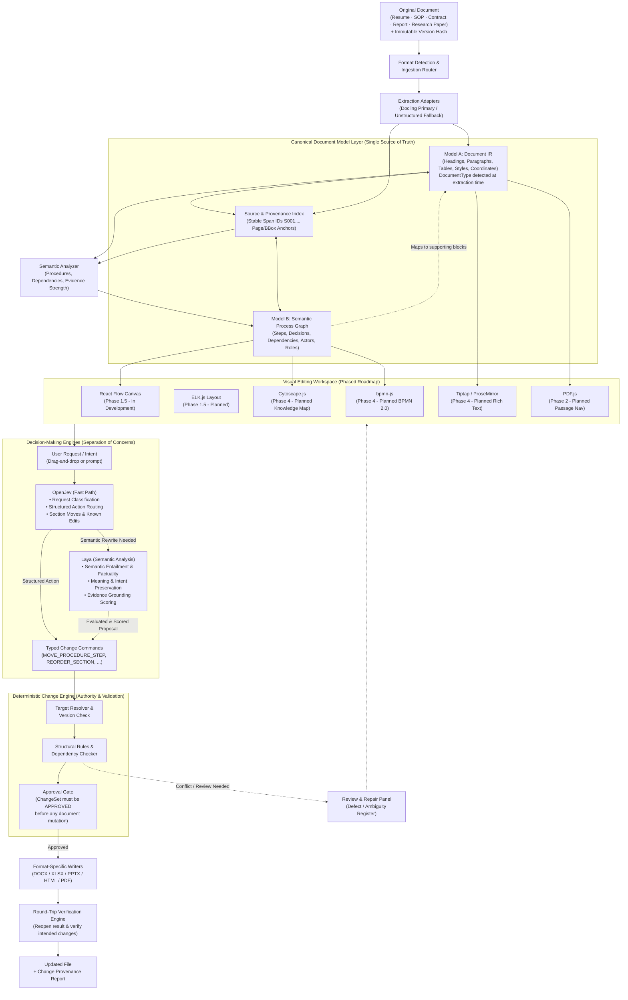

# Beelzebuth — High-Level Architecture & Open-Source Stack (Locked Specification)

> **Source-Preserving Document Intelligence Engine with a Separate Semantic Process Graph, Visual Editing Layer, and Format-Specific Recompilers.**

---

## 1. Executive Architecture Overview

Beelzebuth combines mature open-source tools with one proprietary, tightly engineered core: **the Canonical Document Model (CDM) and the bidirectional mapping between visual edits and the original document package.**



---

## 2. Core Subsystems

### A. Ingestion and Extraction
- **Format Detection & Ingestion Router**: Detects file format, computes cryptographic SHA-256 hash, and archives the immutable original artifact.
- **Specialized Adapters**:
  - **Docling (Primary)**: IBM Docling extracts structured `DoclingDocument` with layout analysis, TableFormer deep learning table recognition, reading order, and bounding boxes.
  - **Unstructured (Alternative)**: Fast heuristic partitioning for heterogeneous documents.
  - **PaddleOCR / PP-Structure (Specialist)**: Reserved for scanned documents, degraded scans, and deep OCR.
- **Automatic DocumentType Detection**: At extraction time, `detect_document_type()` classifies the document into one of six categories:
  - `MANUAL`: SOPs, technical manuals, installation guides (activates procedural step extraction).
  - `RESUME`: CV / Resumes (activates section reordering and experience bullet editing).
  - `CONTRACT`: Legal agreements, NDAs (activates clause and obligation overlays).
  - `RESEARCH_PAPER`: Academic papers (activates citation and equation overlays).
  - `REPORT`: Business proposals, executive summaries.
  - `GENERIC`: All other structured documents (activates procedural step extraction by default).

### B. Canonical Document Model (CDM): The Two-Model Architecture
Beelzebuth rejects the naive approach of using one giant graph. It enforces a strict separation between what is physically in the source and the semantic meaning derived from it:

```
┌────────────────────────────────────────────────────────────────────────────────────────┐
│                        CANONICAL DOCUMENT MODEL (CDM)                                  │
├───────────────────────────────────────────┬────────────────────────────────────────────┤
│         MODEL A — DOCUMENT IR             │       MODEL B — SEMANTIC PROCESS GRAPH     │
│   (Faithful Structural Source Representation)│    (Interpreted Procedures & Relations)     │
├───────────────────────────────────────────┼────────────────────────────────────────────┤
│ • Headings, Paragraphs, Lists, Tables     │ • Procedures, Steps, Gateways, Decisions   │
│ • Stable internal block IDs (block-001...) │ • Actors, Tools, Preconditions, Outputs    │
│ • DocumentType classification             │ • Directed dependency edges (DEPENDS_ON)   │
│ • Formatting metadata (styles, runs, XML) │ • Links each node to >= 1 source blocks    │
│ • Physical source anchors (page, bbox)    │ • Retains inference confidence & evidence  │
│ • Extended block types: FIGURE_CAPTION,   │ • procedure_parent_block_id scope          │
│   CITATION, EQUATION, CLAUSE              │   enforcement prevents cross-section moves │
└───────────────────────────────────────────┴────────────────────────────────────────────┘
```

**Why Both Models Are Essential:**
- A single procedural step (e.g. *“Configure RAID 10 Array”*) may be supported by a paragraph on page 12, a specifications table on page 14, and a critical warning on page 18.
- Conversely, a single dense paragraph may contain three sequential procedural actions.
- Model A preserves document identity and layout formatting; Model B provides an editable visual projection of meaning.

---

## 3. Decision-Making Engines: Separation of Responsibilities

A key design principle in Beelzebuth is **specialized roles for decision-making models** rather than expecting one model to do everything.

```
┌────────────────────────────────────────────────────────────────────────────────────────┐
│                                 DECISION-MAKING MATRIX                                 │
├───────────────────┬─────────────────────────────────────┬──────────────────────────────┤
│ COMPONENT         │ CORE RESPONSIBILITY                 │ WHAT IT DOES NOT DO          │
├───────────────────┼─────────────────────────────────────┼──────────────────────────────┤
│ **OpenJev**       │ **Fast Path**: Request classification│ Does NOT evaluate complex    │
│ (AlexWortega)     │ and rapid routing to supported      │ semantic entailment or       │
│                   │ structured actions (e.g. section    │ factual nuance; never edits  │
│                   │ moves, known typed commands).       │ document binaries.           │
├───────────────────┼─────────────────────────────────────┼──────────────────────────────┤
│ **Laya**          │ **Semantic Analysis**: Evaluates    │ Is NOT a general-purpose     │
│ (convaiinnovations)│ meaning preservation, intent, and  │ planner; does NOT authorize  │
│                   │ factual support against cited spans.│ destructive document edits.  │
├───────────────────┼─────────────────────────────────────┼──────────────────────────────┤
│ **Change Engine** │ **Deterministic Authority**: Target  │ Does NOT guess user intent;  │
│ (Deterministic)   │ resolution, version checking,       │ executes verified, approved  │
│                   │ structural rules, approval gate,    │ commands deterministically.  │
│                   │ OOXML AST mutation, & verification. │                              │
└───────────────────┴─────────────────────────────────────┴──────────────────────────────┘
```

### 1. OpenJev: The Fast Path Router
- **Role**: Quick intent classification and dispatch to structured actions.
- **When Activated**: Every incoming user prompt or visual action.
- **Capabilities**:
  - Classifies whether a user request corresponds to a supported structural operation (e.g., *"Move skills above education"* ➔ `REORDER_SECTION`, *"Swap Step 1 and Step 2"* ➔ `MOVE_PROCEDURE_STEP`).
  - Emits candidate `TypedChangeCommand` structures for supported operations.
  - If the request requires generative semantic rewriting (e.g., *"Rewrite my work history to emphasize Kubernetes"*), OpenJev routes the request to the generative path and flags it for Laya semantic analysis.

#### OpenJev Schema Mapping (Candidate)
```json
{
  "request_intent": "STRUCTURED_REORDER | CONTENT_UPDATE | SEMANTIC_REWRITE | AMBIGUOUS",
  "target_operation": "REORDER_SECTION | MOVE_PROCEDURE_STEP | EDIT_PARAGRAPH_TEXT",
  "target_identifiers": {
    "source_entity": "skills_section",
    "anchor_entity": "education_section",
    "position": "BEFORE"
  },
  "confidence": 0.94,
  "requires_semantic_analysis": false
}
```

### 2. Laya: The Semantic Analysis Engine
- **Role**: Non-autoregressive factual consistency and entailment assessment.
- **When Activated**: When content has been rewritten, modified, or generated by an AI model.
- **Capabilities**:
  - Evaluates whether rewritten text preserves the facts asserted in the original document spans.
  - Checks actor grounding, action entailment, modality preservation (e.g., ensuring a "mandatory" step wasn't weakened to "optional"), and epistemic status.
  - Assigns an Evidence Strength rating: `STRONG`, `MODERATE`, `WEAK`, or `NONE`.
  - Flags unsupported factual additions for quarantine in the Defect / Ambiguity Register.

#### Laya Schema Mapping
```json
{
  "state": {
    "claim": "Rewritten experience bullet or updated procedure instruction",
    "evidence": "Original source span text [S012...]",
    "actor": "Software Engineer / System Admin",
    "action": "Deploy Kubernetes clusters"
  },
  "verdict": {
    "action_entailed": 0.96,
    "actor_grounded": 0.92,
    "modality_preserved": "mandatory",
    "epistemic_status": "confirmed",
    "evidence_strength": "STRONG",
    "unsupported_additions": []
  }
}
```

### 3. The Change Engine: Deterministic Control & Verification
Neither OpenJev nor Laya directly edits files. The **Change Engine owns the document boundary**:
1. **Target Resolution**: Maps logical identifiers (e.g., `"skills"`, `"step-02"`) to physical `DocumentBlock` entries in `DocumentIR`.
2. **Version Checking**: Verifies `expected_document_version` matches the active session.
3. **Structural Validation**: Checks procedure scope (`step_parent_map`), dependency cycles, and unsupported OOXML structures.
4. **Approval Gate**: Requires explicit status `APPROVED` before any recompilation.
5. **Surgical Mutation**: Patches targeted XML nodes via `DocxPackagePatcher`.
6. **Round-Trip Verification**: Re-extracts the output file to guarantee one-to-one block reconciliation (`matched_reopened_ids`).

---

## 4. Multi-Document Support: Beyond Process & SOP Workflows

Beelzebuth is a **general-purpose document transformation engine**, not merely an SOP editor. Documents of different types are represented through their native structures:

| Document Type | Native Structural Unit | Primary Fast-Path Action (OpenJev) | Primary Semantic Check (Laya) | Recompiler Target |
| :--- | :--- | :--- | :--- | :--- |
| **Resume / CV** | Sections, Experience bullets, Skills entries | `REORDER_SECTION` (e.g. Skills before Education) | Factual consistency of rewritten experience bullets | DOCX (preserves template formatting & margins) |
| **SOP / Manual** | Procedures, Grounded Steps, Warnings | `MOVE_PROCEDURE_STEP` (reorder steps) | Action entailment, prerequisite & safety preservation | DOCX (preserves numbered lists & styles) |
| **Contract** | Clauses, Obligations, Definitions | `REORDER_SECTION`, `UPDATE_CLAUSE` | Obligation modality preservation (`mandatory` vs `permissive`) | DOCX / PDF Reconstruction |
| **Business Report** | Chapters, Executive Summary, Tables | `REORDER_SECTION`, `EDIT_PARAGRAPH_TEXT` | Claim evidence grounding from appendix data | DOCX / HTML |
| **Research Paper** | Abstract, Methodology, Citations, Equations | `REORDER_SECTION`, `UPDATE_CITATION` | Citation grounding & claim entailment | DOCX / Pandoc / PDF |

---

## 5. Visual Projections and Editors

Visual projections share canonical document and semantic IDs across domain-appropriate visual views. Components are phased across releases to prioritize foundational correctness:

| Component | Technology | Target Phase | Status | Purpose & Capabilities |
| :--- | :--- | :--- | :--- | :--- |
| **Workflow Studio Canvas** | React Flow (`@xyflow/react`) | Phase 1.5 | **In Development** | Interactive step graph canvas rendering procedural nodes and transitions from Process Graph AST. |
| **Graph Auto-Layout** | ELK.js (`elkjs`) | Phase 1.5 | **Planned** | Automatic layered graph layout and edge routing to eliminate visual crossings in complex workflows. |
| **Embedded PDF Viewer** | PDF.js (`pdfjs-dist`) | Phase 2 | **Planned** | In-browser PDF navigation jumping directly to supporting source page and passage coordinates. |
| **Knowledge Map** | Cytoscape.js | Phase 4 | **Planned** | Cross-document relationship exploration (roles, warnings, prerequisites, system constraints). |
| **Formal BPMN Modeler** | bpmn-js | Phase 4 | **Planned** | Formal BPMN 2.0 XML visual modeling and export for strict enterprise workflow compliance. |
| **Source-Linked Rich Text** | Tiptap / ProseMirror | Phase 4 | **Planned** | Structured rich-text block editing with live citation badges and transactional mutation history. |

---

## 6. How Format-Specific Recompilation Works

| Format | Recompilation Approach | Guarantees & Constraints |
| :--- | :--- | :--- |
| **DOCX** | Patch the Office Open XML package using `zipfile` + targeted `lxml` surgery. Source file is re-hashed immediately before mutation to detect concurrent modification. | **Style-Preserving Same-Format Editing**. Untouched paragraphs, styles, headers, footers, and margins remain identical. One-to-one block matching ensures no dropped blocks. |
| **XLSX** | Modify workbook with `openpyxl`. | Preserves formulas, cell styles, sheet names, and workbook metadata. |
| **PPTX** | Edit slides and shapes with `python-pptx`. | Preserves slide layouts, themes, and master slides. |
| **HTML** | Mutate DOM tree using BeautifulSoup / lxml. | Retains classes, attributes, links, and structure. |
| **PDF** | Constrained in-place updates or clean reconstruction. | PDFs are fixed-layout print artifacts; Beelzebuth provides a defined **reconstruction mode** rather than claiming impossible lossless PDF patching. |

---

## 7. Architectural Invariants

1. **Primacy of the Dual Canonical Model**: Document IR (Model A) and Semantic Process Graph (Model B) are linked sources of truth. Diagrams and Markdown are merely projected views.
2. **Models Interpret and Assess; Change Engine Controls and Verifies**: AI models (OpenJev, Laya, LLMs) propose, classify, and assess; the deterministic Change Engine owns validation, approval gates, and recompilation.
3. **Approval Gate & Cryptographic Boundary**: No document mutation may occur without an explicitly `APPROVED` ChangeSet. Approval generates an HMAC-SHA256 signature binding the exact document version, authenticated principal identity, and canonical command payload digest. Approved ChangeSets are deeply frozen (`is_frozen=True`, `FrozenDict`, `FrozenList`). Keys are provisioned automatically for local single-user mode (0600 file permissions) and explicitly required via `APPROVAL_SIGNING_KEY` for multi-user/production deployments (zero source-embedded fallback secrets).
4. **General Documents Are Never Forced into SOP Workflows**: Resumes, contracts, reports, and papers use structural block editing without hallucinated procedure graphs.
5. **No Lossless PDF Guarantees**: A flattened PDF has no editable semantic source package. Beelzebuth provides a defined, high-fidelity **reconstruction mode** rather than claiming impossible lossless PDF patching.
6. **Style Preservation in Same-Format Editing**: Editing a DOCX modifies only targeted OpenXML elements; untouched sections remain identical.
7. **Four-Tier Evidence Scoring**: All extracted and edited claims are scored as `STRONG`, `MODERATE`, `WEAK`, or `NONE` (new addition).
