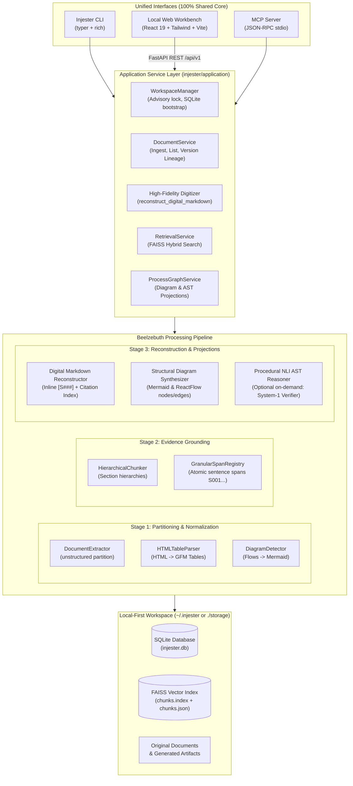
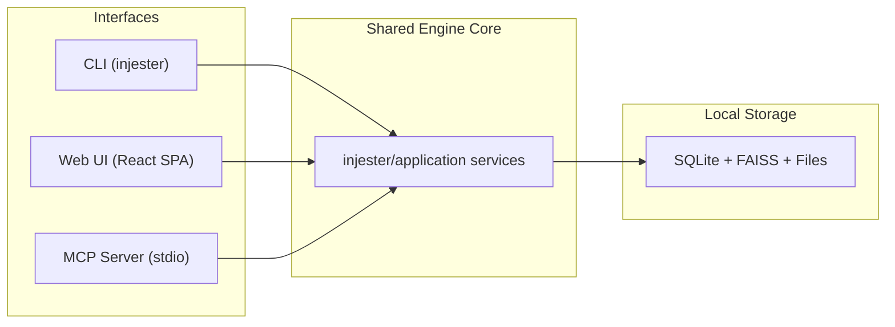
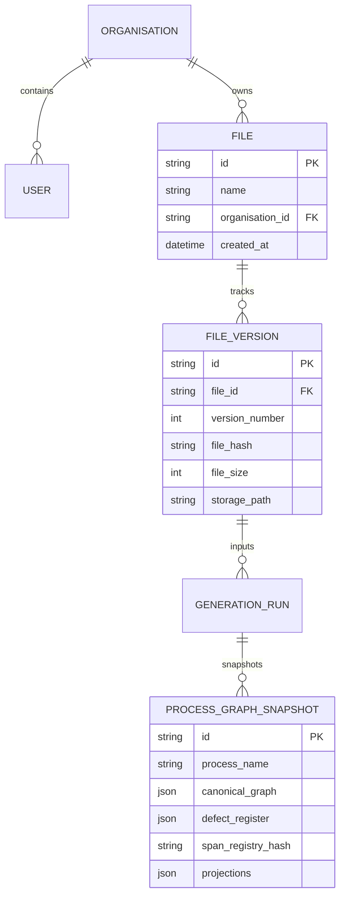
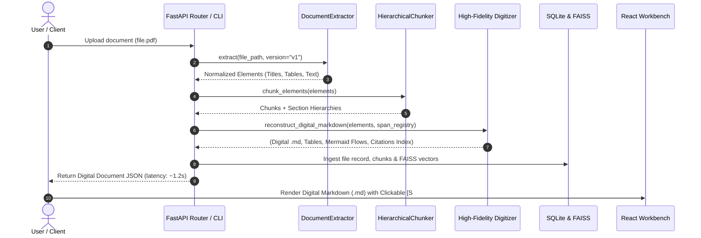

# Beelzebuth (Injester Community) — Full System Architecture

This document provides a comprehensive technical breakdown of the architecture powering **Beelzebuth** (Injester Community). 

The primary mission of the core engine is:
> **Universal Open-Source Document Digitizer**: Devour any incoming document format (`.pdf`, `.docx`, `.txt`, `.md`, images) into an authoritative, editable, and high-fidelity digital **Markdown (`.md`)** document, preserving 100% of the original context, tables, diagrams/figures, and attributing every claim with granular inline citations `[S###]` anchored to an auditable Citation & Source Provenance Index.

---

## 1. High-Level System Architecture



---

## 2. The Three Unified Interfaces

All three interfaces call the exact same underlying application service layer, preventing code fragmentation or inconsistent behavior:



| Interface | Technology | Primary Functionality |
| :--- | :--- | :--- |
| **CLI (`injester`)** | Python Typer + Rich | Instant terminal devouring (`injester md generate -f doc.pdf -o doc.md`), workspace initialization (`injester init`), diagnostics (`injester doctor`), vector search (`injester search`), and starting local servers (`injester web`, `injester mcp`). |
| **Web Workbench** | React 19, Vite, Tailwind CSS, XYFlow, Lucide Icons | Dual-pane visual workbench: left pane displays immutable document evidence with highlight tracking; right pane features the **Digital Markdown (.md)** editor/viewer, interactive diagram visualizers, LLM context, and schema viewer. |
| **MCP Server** | Official Python MCP SDK (`stdio`) | Exposes tools (`list_documents`, `ingest_document`, `search_evidence`, `generate_digest`, `generate_diagram`) to AI desktop clients like Claude Desktop, Cursor, and Windsurf. |

---

## 3. Core Processing Pipeline Deep Dive

### Tier 1: Ingestion & Partitioning
- **Location**: `injester/ingestion/extractor.py`
- **Supported Formats**: PDF, DOCX, XLSX, CSV, TXT, Markdown, PPTX, HTML, Images.
- **Engine**: Powered by `unstructured.partition.auto.partition`.
- **Metadata Capture**: Normalizes document structures into `NormalizedElement` instances, recording:
  - Element type (`Title`, `Header`, `NarrativeText`, `ListItem`, `Table`, `FigureCaption`).
  - Section path hierarchy (`['Section 1', 'Sub-clause 1.2']`).
  - Page coordinates and page numbers.
  - Raw HTML representation for tables (`metadata.text_as_html`).
  - Associated figure or image paths (`metadata.image_path`).

### Tier 2: Granular Span Registry & Grounding
- **Location**: `injester/synthesis/spans.py` & `injester/semantic/pipeline.py`
- **Segmentation**: Granular sentence-level splitting using regex lookarounds that preserve numbering, procedural steps, and sub-bullets (`(?<=[.?!;:])\s+(?=(?:step\s+\d+|\d+[\.)]|[a-zA-Z][\.)]|[•\-*])\s+)`).
- **Immutable Span IDs**: Every atomic unit of source text receives a deterministic identifier: `S001`, `S002`, `S003`...
- **Cryptographic Lineage**: Generates a SHA-256 hash manifest representing the span registry snapshot to guarantee zero synthetic drift between the original file and synthesized outputs.

### Tier 3: High-Fidelity Digitizer
- **Location**: `injester/application/digitizer.py`
- Recreates the document structure deterministically in **< 1.5 seconds**:
  1. **HTML Table to GFM Parsing**:
     - `HTMLTableParser` parses raw `<table>...</table>` trees from element metadata.
     - Strips nested tags, cleans non-breaking whitespace, measures column widths, and produces aligned GitHub-Flavored Markdown:
       ```markdown
       | Column A | Column B | Column C |
       | :--- | :--- | :--- |
       | Value 1 | Value 2 | Value 3 |
       ```
  2. **Diagram & Flow Sequence Detection**:
     - Scans for transition arrows (`->`, `-->`, `=>`) or numbered progression patterns (`Phase 1 -> Phase 2`).
     - Emits inline Mermaid diagram code blocks directly within the Markdown:
       ````markdown
       ```mermaid
       graph TD
         A["Step 1"] --> B["Step 2"]
       ```
       ````
  3. **Inline Citation Tagging**:
     - Appends `[S###]` badges to each sentence corresponding to its registered evidence span.
  4. **Auditable Citation Index**:
     - Renders a clean Markdown table at the end of the document:
       ```markdown
       ## Citation & Source Provenance Index
       | Citation | Page / Location | Section Path | Source Excerpt |
       | :--- | :--- | :--- | :--- |
       | `[S001]` | Page 1 | Security Protocol | *"All access requests require dual sign-off."* |
       ```

### Tier 4: Diagram & AST Projection Engine
- **Location**: `injester/application/digitizer.py` & `injester/semantic/projections.py`
- **Fast Structural Diagrams**: Synthesizes Mermaid flowcharts and ReactFlow node/edge graphs directly from document headings and sections without requiring slow LLM calls.
- **On-Demand Procedural AST**: When formal workflow compilation is requested:
  - System-1 NLI checks candidate claims against source spans.
  - Validated steps compile into `GroundedProcessGraph`.
  - Projects to standard BPMN 2.0 XML, Mermaid Flowcharts, Swimlanes, and State Machines.
  - Quarantines unverified assertions into an `AmbiguityRegister` (Defect Register).

---

## 4. Local Data & Storage Layer



1. **SQLite (`injester.db`)**:
   - Manages tenant boundaries (in multi-tenant enterprise mode) or single-workspace local state (`COMMUNITY_MODE=true`).
   - Maintains version lineage, audit logs, file records, and snapshot registries.
2. **FAISS Vector Store (`chunks.index` & `chunks.json`)**:
   - Uses `sentence-transformers/all-MiniLM-L6-v2` (or configured embedding model) to generate 384-dimensional dense vectors.
   - Enables sub-millisecond semantic similarity search across millions of chunks.
3. **Local File Store (`storage/`)**:
   - Stores raw ingested files (`.pdf`, `.docx`, etc.) alongside their generated `.md` and diagram artifacts.

---

## 5. End-to-End Execution Flow



---

## 6. Key Architectural Guarantees

1. **Sub-2-Second Digitization**: By separating fast document digitization from optional, heavy procedural LLM reasoning, document devouring completes in 1 to 2 seconds.
2. **Zero False Hallucinations**: Every sentence in the generated Markdown is traceable to an exact span ID `[S###]` with line and section provenance.
3. **Zero Hardcoded Data**: Removed all static sample mocks, hardcoded fallbacks, and dummy arrays. The workstation displays exclusively real evidence from user files or renders a clean empty state.
4. **Preserved Tables & Visuals**: Table structures are rendered as GFM tables rather than raw text blobs, and sequential flows are transcribed into native Mermaid diagrams.
5. **No Synthetic Drift**: Documents (resumes, technical specifications, policy whitepapers, manuals) are treated as informative digital documents rather than being forced into procedural enterprise policy graphs.
